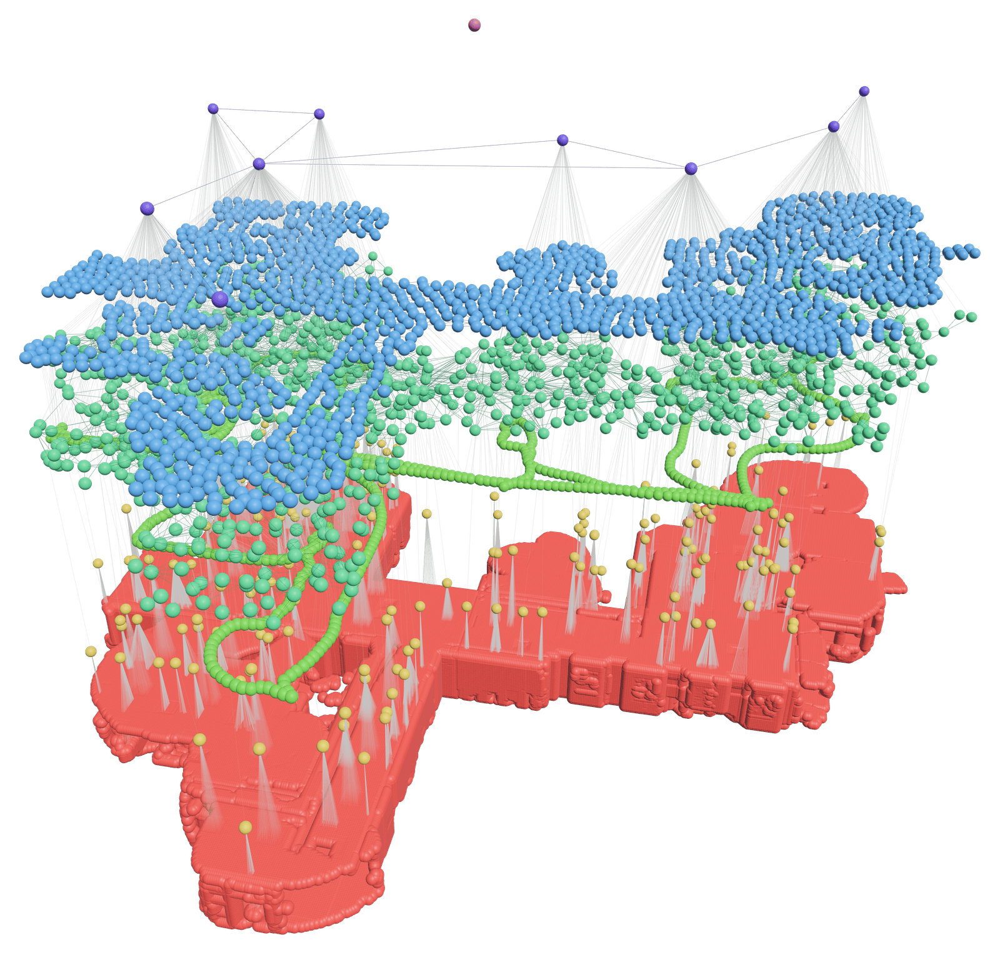

<p align="center">
  
</p>

<h1 align="center"><ins>Y</ins>et another <ins>G</ins>ood <ins>G</ins>raph for <ins>D</ins>ynamic <ins>R</ins>e<ins>A</ins>ltime <ins>S</ins>cene <ins>I</ins>nteraction and <ins>L</ins>earning.</h1>

<p align="center">
  Like <a href="https://en.wikipedia.org/wiki/Yggdrasil">Yggdrasil</a> binding the Nine Realms, this system maintains the ‘world-tree’ of 3D scene data,<br/>
  reconciling distributed updates and serving coherent subgraphs across heterogeneous agents.
</p>

<p align="center">
  <a href="https://arxiv.org/abs/2609.38640"></a>
  
  <a href="LICENSE"></a>
  <a href="https://github.com/brdsdsu/Yggdrasil/actions/workflows/ci.yml"></a>
  <a href="#install"></a>
  <a href="#python"></a>
</p>

<p align="center">
  <a href="https://arxiv.org/abs/2609.38640">Paper</a> ·
  <a href="https://brdsdsu.github.io/Yggdrasil/">Book</a> ·
  <a href="https://github.com/brdsdsu/Yggdrasil/issues">Issues</a> ·
  <a href="CONTRIBUTING.md">Contributing</a>
</p>

---

### Try Yggdrasil

```bash
git clone https://github.com/brdsdsu/Yggdrasil.git && cd Yggdrasil
cargo run --release -p viz                   # explore the built-in demo scene in 3D
cargo run -p scene-graph --example demo      # the book's walkthrough, as one program
```

<p align="center">
  
</p>

Building a graph and querying it takes a few lines:

```rust
use scene_graph::{Coordinate, Feature, Observer, PosQueryCount, SceneGraph};

fn main() -> scene_graph::Result<()> {
    let mut sg = SceneGraph::default();

    // Layers form a DAG: measured points sit under the objects they belong to.
    let points = sg.new_indexed_layer().id;
    let objects = sg.new_layer().id;
    sg.layer_mut(objects)?.add_child(points)?;

    // One semantic node, with three measured points nested under it.
    let car = sg.new_node(vec![Feature::new("type", "car")]);
    let car = sg.layer_mut(objects)?.push_node(car)?;
    for x in [0.0, 1.0, 2.0] {
        let point = sg.new_coordinates(x, 0.0, 0.0, vec![]);
        let point = sg.layer_mut(points)?.push_node(point)?;
        sg.nest(point).under(car)?;
    }

    // Spatial, semantic and field-of-view queries over the same graph.
    let nearest = sg.nearest_nodes(&Coordinate::new(0.9, 0.0, 0.0), PosQueryCount::Count(2));
    let cars = sg.nodes_matching(&[&Feature::new("type", "car")]);
    let camera = Observer::new_looking_along(Coordinate::new(-5.0, 0.0, 0.0), Coordinate::X, 0.5, 0.1, 6.0)?;
    let in_view = sg.visible_subgraph(&camera, car)?;
    Ok(())
}
```

The [Yggdrasil Book](https://brdsdsu.github.io/Yggdrasil/) builds a full demo scene and walks
through every query family.

---

### Why Yggdrasil

| | Without Yggdrasil | With Yggdrasil |
|---|---|---|
| **Spatial queries** | A k-d tree bolted on per project | Nearest-neighbor, radius and field-of-view queries built in |
| **Semantics** | Side tables keyed by id | Key–value features on nodes, labelled edges between them |
| **Hierarchy** | Ad-hoc parent pointers | A layer DAG that decides what may nest under what |
| **Derived state** | Recomputed by hand after every edit | Bounding boxes and position indexes kept current on every change |
| **Sharing with agents** | Ship the whole graph | Extract the subgraph an agent needs, merge its updates back |

---

### The model

**Layer → Nest → Index → Query**

| Step | What happens |
|---|---|
| **Layer** | `new_layer()` allocates an isolated graph of nodes and edges. `add_child` arranges layers into a DAG, from point clouds at the bottom to objects, rooms or a single root at the top. A layer can only be the child of a layer created after it. |
| **Nest** | Nodes carry key–value features and, optionally, coordinates. `nest(child).under(parent)` builds the hierarchy, and is allowed only where the parent's layer is a parent of the child's layer. Edges stay within a layer. |
| **Index** | Indexed layers and nodes keep a k-d tree over the coordinates beneath them; bounded nodes keep an axis-aligned box. Both update as nodes move, nest or detach. |
| **Query** | Label, edge, nearest-neighbor, radius, field-of-view and subgraph queries, each at graph, layer or subtree scope. |

---

### How it works

```
   python-binding (PyO3)          viz (Bevy)          engine (update pipeline)
            │                         │                          │
            └─────────────────── scene-graph ────────────────────┘
                                      │
                    spatial-index (k-d tree, fork of kiddo)
```

`scene-graph` is the core library: layers, nodes, edges, bounds, the `Observer` view
frustum, and every query. It is pure Rust. A `SceneGraph` serializes with serde, so a
graph can be written to JSON and opened in the visualizer.

`spatial-index` backs the optional position indexes. It is a vendored fork of
[kiddo](https://github.com/sdd/kiddo) whose k-d tree picks each split axis from the
spread of the points in the bucket instead of cycling axes with tree depth. Upstream refuses
an insert when a full leaf's points all share one value on the cycled axis, and voxel-quantized
indoor scans put thousands of points on one plane. [`spatial-index/README.md`](spatial-index/README.md) records the
provenance and every deviation.

`engine` is the runtime that will own conflict resolution and lazy evaluation of updates;
today it queues incoming subgraphs and merges them in order on read. `python-binding`
exposes the library to Python, and `viz` is an interactive Bevy viewer.

| Crate | What it is |
|---|---|
| [`scene-graph`](scene-graph/) | Core data structure and queries |
| [`spatial-index`](spatial-index/) | k-d tree with an adaptive split policy (kiddo fork) |
| [`engine`](engine/) | Update pipeline for merging agents' subgraphs (early) |
| [`python-binding`](python-binding/) | PyO3 bindings, packaged as `yggdrasil-3d` and imported as `yggdrasil` |
| [`viz`](viz/) | Bevy visualizer: layer toggles, node inspection, queries |
| [`bench`](bench/) | Benchmark harness, `spatial-index` against upstream kiddo |
| [`docs`](docs/) | The Yggdrasil Book (mdBook) |

The book also plans a distributed service for edge deployments and adapters such as ROS 2;
neither is in this repository yet.

---

### Performance

Positional queries are only as fast as the index behind them, and an index is only as cheap
as the updates it absorbs. Yggdrasil makes that trade explicit and per-layer:

- **Indexing is opt-in.** `new_indexed_layer` and `new_indexed_node` keep a k-d tree current
  on every coordinate change; plain layers and nodes answer the same queries without one.
- **Split static from dynamic.** Keep objects that rarely move in their own indexed layer, so
  only the dynamic layer's index churns.
- **Bounds are nearly free.** A new coordinate almost always falls inside its parent's box
  already, so bounding-box updates rarely propagate.

[A Note On Performance](https://brdsdsu.github.io/Yggdrasil/6_a_note_on_performance.html)
covers the trade-offs in depth. `bench/` measures `spatial-index` against upstream kiddo in one
binary on identical inputs; [`bench/BASELINE.md`](bench/BASELINE.md) documents the
methodology and noise floor.

---

### Integrations

#### Python

```bash
cd python-binding
uv sync                              # creates .venv with maturin
uv run maturin develop --release     # builds the extension into it
```

```python
import yggdrasil as ygg

sg = ygg.SceneGraph()
points = sg.new_layer().lid
objects = sg.new_layer().lid
sg.layer(objects).add_child(points)

car = sg.layer(objects).push_node(sg.new_node([ygg.Feature("type", "car")]))
for x in (0.0, 1.0, 2.0):
    point = sg.layer(points).push_node(sg.new_coordinates(x, 0.0, 0.0, []))
    sg.nest(point, car)

node, dist = sg.nearest_nodes((0.9, 0.0, 0.0), ygg.PosQueryCount.Count(2))[0]
```

The module mirrors the Rust API, and ships type stubs in
[`yggdrasil.pyi`](python-binding/yggdrasil.pyi) for editor completion.

#### Visualizer

```bash
cargo run --release -p viz                     # built-in 4-layer demo scene
cargo run --release -p viz -- --demo-multi     # same scene, one multi-coordinate node per object
cargo run --release -p viz -- scene.json       # your own graph, saved with serde_json
```

Toggle layers, bounding boxes and nesting edges, hover a node to inspect its features, and
run queries from the side panel with the results highlighted in the scene.

---

### Install

**Rust**: Yggdrasil is not on crates.io yet (the `yggdrasil` crate there is an unrelated
project). Depend on it from Git:

```bash
cargo add scene-graph --git https://github.com/brdsdsu/Yggdrasil
```

```rust
use scene_graph as yggdrasil;   // the book's examples use this alias
```

**Python**: build the bindings from source as shown under [Python](#python), or build a
wheel with `uv run maturin build --release` and `pip install` it from the workspace's
`target/wheels/`.

**From source**:

```bash
cargo build --release --workspace
```

<details>
<summary><b>Platform notes</b></summary>

<br/>

- **Rust**: stable, edition 2024. The vendored `spatial-index` needs 1.89 or newer.
- **Linux and `viz`**: Bevy needs system libraries. On Debian or Ubuntu:

  ```bash
  sudo apt-get install pkg-config libx11-dev libasound2-dev libudev-dev libwayland-dev libxkbcommon-dev
  ```

  `viz` enables Bevy's Wayland backend alongside X11.
- **Python**: 3.8 or newer, with maturin 1.10 or newer.
- **Docker**: the [`Dockerfile`](Dockerfile) builds an Ubuntu 24.04 image with Rust.

</details>

---

### API at a glance

Every call below is on `SceneGraph`; most also run on a single layer
(`sg.layer(id)?.nearest_nodes(...)`) and exist under the same names in Python.

**Build the graph**

```rust
sg.new_layer()                          // allocate a layer; new_indexed_layer() also indexes it
sg.layer_mut(parent)?.add_child(child)? // arrange layers into a DAG
sg.new_node(features)                   // a semantic node
sg.new_coordinates(x, y, z, features)   // a node with a position
sg.new_indexed_node(features)           // a node that indexes the coordinates in its subtree
layer.push_node(node)?                  // insert it; returns its NodeId
sg.nest(child).under(parent)?           // parent–child link across layers
sg.detach(child).from(parent)?          // undo it
layer.add_edge(src, dst, "holding")?    // labelled edge within a layer
sg.del_node(id)?                        // remove a node
```

**Retrieve**

```rust
sg.node(id)?                            // node_mut(id)? for mutable access
sg.nodes_matching(&[&feature])          // nodes with these features, per layer
sg.nodes_having(&["type"])              // nodes with these keys, per layer
sg.edges_matching("holding")            // edges by label, per layer
sg.edges_from(id)                       // edges_to(id) for the reverse
```

**Spatial**

```rust
sg.nearest_nodes(&coord, PosQueryCount::Count(5))
sg.nodes_within(&coord, radius, PosQueryCount::All)
sg.nearest_in_subtree(&coord, root, PosQueryCount::Count(5))?
sg.visible_subgraph(&observer, root)?   // what a camera sees, as a new SceneGraph
sg.visible_in_subtree(&observer, root)  // the same, as node ids
```

**Graph**

```rust
sg.subgraph(root)?                      // everything under a node, as its own SceneGraph
sg.merge(subgraph)?                     // fold an agent's updated subgraph back in
```

**Workspace**

```bash
cargo test --workspace                  # every crate's tests
cargo doc -p scene-graph --open         # API reference
mdbook serve docs --open                # the book, live-reloading
cargo run --release -p bench            # spatial-index against upstream kiddo
```

---

### Citation

If you use Yggdrasil in your research, please cite the paper,
[*Yggdrasil: a Layer-First 3D Scene Graph for Real-Time Querying*](https://arxiv.org/abs/2609.38640):

```bibtex
@misc{akhavan2026yggdrasillayerfirst3dscene,
  title         = {Yggdrasil: a Layer-First 3D Scene Graph for Real-Time Querying},
  author        = {Arshia Akhavan and Ermanno Bartoli and Afnan Algharbi and Alireza Hoseinpur and Iolanda Leite and Bryan Donyanavard},
  year          = {2026},
  eprint        = {2609.38640},
  archivePrefix = {arXiv},
  primaryClass  = {cs.RO},
  url           = {https://arxiv.org/abs/2609.38640},
}
```

The **Cite this repository** button in the GitHub sidebar gives the same citation in APA
and BibTeX, from [`CITATION.cff`](CITATION.cff).

---

### Contributing

Issues and pull requests are welcome. See [CONTRIBUTING.md](CONTRIBUTING.md) for local
setup and conventions, [CODE_OF_CONDUCT.md](CODE_OF_CONDUCT.md) for community standards,
and [SECURITY.md](SECURITY.md) to report a vulnerability.

<p align="center">
  <a href="https://arxiv.org/abs/2609.38640">Paper</a> ·
  <a href="https://brdsdsu.github.io/Yggdrasil/">Book</a> ·
  <a href="https://github.com/brdsdsu/Yggdrasil/issues">Issues</a> ·
  <a href="CONTRIBUTING.md">Contributing</a>
</p>

<p align="center">
  Licensed under <a href="LICENSE">Apache 2.0</a>; <code>spatial-index/</code> keeps kiddo's MIT OR Apache-2.0.<br/>
  ⭐ Star the repo if Yggdrasil is useful to you.
</p>
