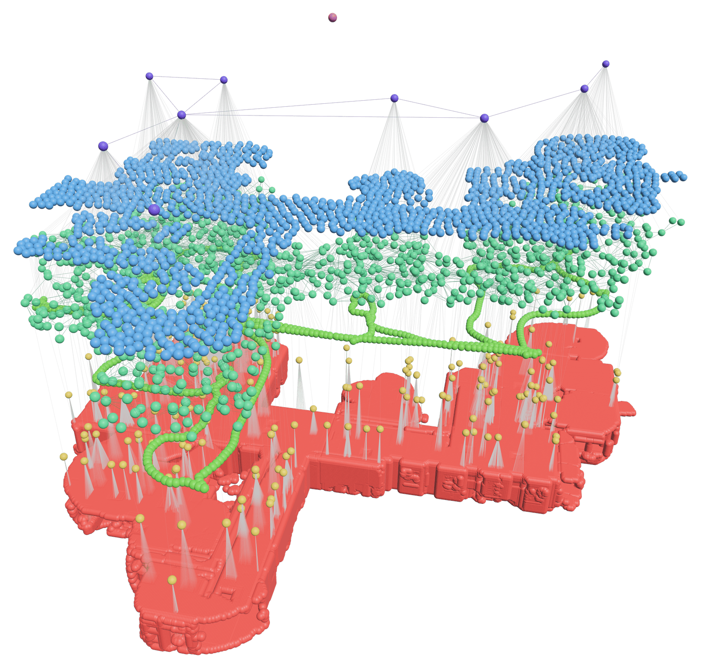

# yggdrasil-3d-viz

An interactive 3D viewer for [Yggdrasil](https://github.com/brdsdsu/Yggdrasil) scene graphs,
built on Bevy.

<p align="center">
  
</p>

## Install

```bash
cargo install yggdrasil-3d-viz
```

On Linux, Bevy needs system libraries first. On Debian or Ubuntu:

```bash
sudo apt-get install pkg-config libx11-dev libasound2-dev libudev-dev libwayland-dev libxkbcommon-dev
```

## Usage

```bash
yggdrasil-3d-viz                        # built-in 4-layer demo scene
yggdrasil-3d-viz --demo-multi           # same scene, one multi-coordinate node per object
yggdrasil-3d-viz scene.json             # your own graph
yggdrasil-3d-viz scene.json --up y      # a scene authored Y-up (the default is Z-up)
```

A scene file is a `SceneGraph` from the
[`yggdrasil-3d`](https://crates.io/crates/yggdrasil-3d) crate, serialized with serde_json:

```rust
std::fs::write("scene.json", serde_json::to_string(&scene_graph)?)?;
```

Toggle layers, bounding boxes and nesting edges, hover a node to inspect its features, and
run queries from the side panel with the results highlighted in the scene.

## License

Apache-2.0.
